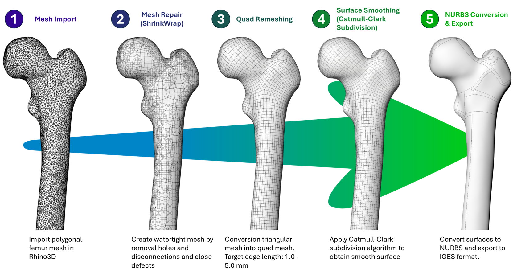

# Mesh2NURBS-Rhino3D
<p align="center">
    
</p>

<p align="center">
    <a href=""></a>
    <a href=""></a>
</p>


# Introduction

A python package for converting 3D meshes into NURBS models (e.g. IGES format) through Rhino3D software.

This work has been presented at **[CAOS 2026](https://caos2026.org/)**. Paper DOI will be published once available.

## Preparing your mesh

Mesh2NURBS-Rhino3D only does the NURBS conversion (steps 1 and 3–5 in the figure above) and expects a clean input mesh. Mesh repair (step 2: filling holes, removing loose fragments and inner shells, shrink-wrapping) is done by the separate package **[MeshFix-Rhino3D](https://github.com/BoneHub/MeshFix-Rhino3D)**.

| Package | Input | Output | Role |
| --- | --- | --- | --- |
| [MeshFix-Rhino3D](https://github.com/BoneHub/MeshFix-Rhino3D) | mesh | mesh | Repair and clean up the mesh |
| **Mesh2NURBS-Rhino3D** | mesh | NURBS (IGES/STEP) | Convert a clean mesh to NURBS |

If your mesh has holes, loose fragments, or is not watertight, repair it with MeshFix-Rhino3D first and then convert the repaired mesh:

```bash
meshfix-rhino3d -i "C:\path\to\mesh.stl" --steps remove-isolated-islands fixholes shrinkwrap
mesh2nurbs-rhino3d -i "C:\path\to\fixed\mesh.stl"
```

Both packages can be installed in the same conda environment.

## Requirements

1.  Rhino 8 needs to be installed and able to be executed from `C:\Program Files\Rhino 8\System\Rhino.exe`
2.  [Miniconda](https://www.anaconda.com/docs/getting-started/miniconda/install/overview)

## Installation

Create a conda environment:

```bash
conda create -n mesh2nurbs-rhino3d python==3.10
```

Activate the environment:

```bash
conda activate mesh2nurbs-rhino3d
```

Install the package:

```bash
pip install git+https://github.com/BoneHub/Mesh2NURBS-Rhino3D.git
```


## Usage

### Command-line

**Note**: Activate the conda environment before running the command-line tool.

The package installs the `mesh2nurbs-rhino3d` command. It launches Rhino, converts one mesh file or all supported meshes in a folder to NURBS, and exports the result as IGES or STEP. To repair meshes before the conversion, see [Preparing your mesh](#preparing-your-mesh).

#### Arguments

| Argument | Type | Default | Description |
| --- | --- | --- | --- |
| `-i, --input-path` | path | current working directory | Input mesh file or folder. If a folder is provided, all `.stl`, `.obj`, and `.ply` files in that folder are processed. |
| `--output-filetype` | one or more of `iges`, `step` | `iges` | Output CAD file type(s). Give several to save all of them, e.g. `--output-filetype iges step`. |
| `--nosubd` | flag | `False` | Skip the SubD step and convert directly to NURBS. Produces non-smooth patch connections. |
| `--packed-patches` | flag | `False` | Pack NURBS patches together during SubD-to-NURBS conversion. Only works when SubD is enabled. |
| `--force-ncps-u` | int | `0` | Force the number of control points in the U direction during rebuild. If `0`, Rhino decides automatically. |
| `--force-ncps-v` | int | `0` | Force the number of control points in the V direction during rebuild. If `0`, Rhino decides automatically. |
| `--quadremesh-length` | float | `2.0` | Target QuadRemesh edge length in millimeters. |
| `--rhino-path` | path | `C:\Program Files\Rhino 8\System\Rhino.exe` | Path to the Rhino executable. |
| `--keep-open` | flag | `False` | Leave Rhino open after processing finishes. |
| `--no-display` | flag | `False` | Avoids displaying objects in Rhino to reduce processing time. |

The mesh preprocessing arguments of version 1.0 (`--preprocessing-steps`, `--smoothing`, `--shrinkwrap-length`) have moved to [MeshFix-Rhino3D](https://github.com/BoneHub/MeshFix-Rhino3D) as `--steps`, `--smoothing`, and `--shrinkwrap-length`.

#### Examples

Process a single mesh with the default pipeline:

```bash
mesh2nurbs-rhino3d -i "C:\path\to\mesh.obj"
```

Use custom remeshing and packed patches:

```bash
mesh2nurbs-rhino3d -i "C:\path\to\mesh.obj" --quadremesh-length 2.5 --packed-patches
```

Skip SubD and convert directly to NURBS:

```bash
mesh2nurbs-rhino3d -i "C:\path\to\mesh.obj" --nosubd
```

Force the NURBS rebuild to use specific control point counts in both directions:

```bash
mesh2nurbs-rhino3d -i "C:\path\to\mesh.obj" --force-ncps-u 8 --force-ncps-v 8
```

Process every supported mesh in a folder and keep Rhino open:

```bash
mesh2nurbs-rhino3d -i "C:\path\to\folder" --output-filetype step --keep-open
```

Recommended argument combinations:

| Argument | Example | Notes |
| --- | --- | --- |
| `--nosubd` | `--nosubd` | Disables SubD; do not use with `--packed-patches` if you want packed output. |
| `--packed-patches` | `--packed-patches` | Use only when SubD is enabled. |
| `--force-ncps-u` | `--force-ncps-u 8` | Must be combined with `--force-ncps-v` and both values must be greater than 3. |
| `--force-ncps-v` | `--force-ncps-v 8` | Must be combined with `--force-ncps-u` and both values must be greater than 3. |
| `--quadremesh-length` | `--quadremesh-length 1.5` | Smaller values create a finer quad remesh. |

